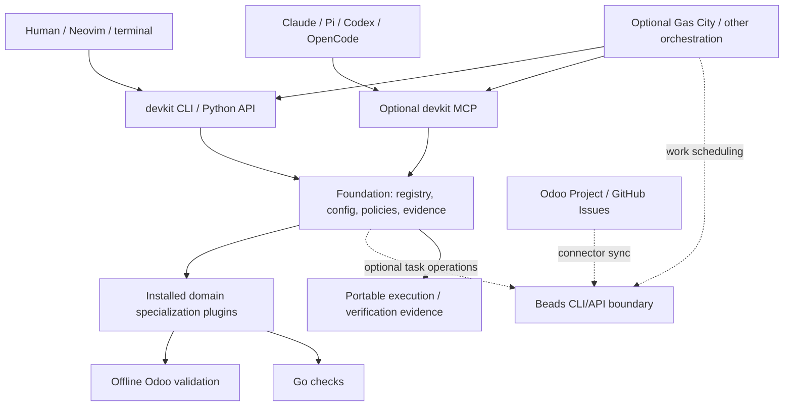

# Composable Developer Toolkit — Architectural Specification

**Status:** Draft 0.3. First-release implementation complete; public names and plugin API remain provisional.\
**Date:** October 30, 2026\
**Working project name:** `devkit` (placeholder, not a proposed public package name)\
**Design inspiration:** [Crpaxton4/devcontainer-features](https://github.com/Crpaxton4/devcontainer-features) and its [ADR-006](https://github.com/Crpaxton4/devcontainer-features/blob/main/docs/design/adr/ADR-006-workspace-three-layers-state-root.md)\
**First-release specializations:** Go checks and offline Odoo validation\
**Core architectural posture:** Build developer capabilities; integrate task tracking and orchestration rather than reinventing them.

## 1. Executive summary

Build a small, framework-agnostic developer-tool foundation from scratch in this project. The foundation owns **discovery, registration, invocation, configuration, permission declarations, and evidence formatting** for developer commands and verification checks. It provides a native CLI and an optional MCP presentation of explicitly authorized commands. Neither Odoo, Beads, Docker, Claude Code, nor an agent orchestrator is a mandatory dependency for running local developer commands.

Specialized behaviors are installed as **versioned Python packages** and activated per project. The first release proves the plugin contract with Go checks and offline Odoo 19 manifest validation. Live Odoo testing is a later increment. The later Odoo Project connector is a separate package. Development commands do not depend on it.

Use Beads as the preferred development work graph when task integration is added after the first release. Beads owns issue identity, statuses, dependencies, readiness, and synchronization. External trackers connect through scoped bridge packages. The core does not maintain a second task database or edit Dolt tables. Agent execution and scheduling belong to existing harnesses and optional orchestrators such as **Gas City**. Gas City packs consume installed domain capabilities; they are not the domain plugin format itself.

The upstream repository supplies design lessons. This project has its own implementation, package layout, tests, configuration, and release lifecycle. Compatibility with upstream commands, state, SDKs, and deployments is outside scope. The [implementation plan](Implementation_Plan.md) defines the delivery slices and their acceptance gates.

## 2. Context and problem

The inspiration repository combines developer commands with Odoo capabilities, several user interfaces, orchestration, and operational state. Its ADR-006 describes focused packages in a `uv` workspace, enforced dependency rules, centralized state resolution, and a shared command registry. These are useful design precedents for a new toolkit.

The problem this project addresses is domain coupling. Discovery, invocation, authorization, and evidence should work across development domains without requiring an Odoo connection or an agent runtime. Starting with both Go and offline Odoo capabilities tests that separation before live services and work tracking enter the design.

Existing upstream projects solve major adjacent problems:

- **Beads:** durable local-first development issues, dependencies, readiness, status, metadata, and Dolt-backed synchronization.
- **Gas City:** optional multi-agent execution, scheduling, reusable packs, formulas, and agent lifecycle orchestration.
- **T3 Code and native harnesses:** agent session/control experiences and provider-specific behavior.

The toolkit should **compose** with them, not compete with them.

## 3. Goals and non-goals

### 3.1 Goals

G1. Run generic developer commands and checks without Odoo, Beads, Docker, or any agent harness installed.\
G2. Install a specialization using standard Python packaging; discover and enable it without changing core source code.\
G3. Offer one command implementation through CLI, Python API, and selectively through MCP; preserve consistent results and permission semantics.\
G4. Use Beads as the default work graph **when task features are enabled**, without copying its issue lifecycle or Dolt persistence.\
G5. Make source-of-work (Odoo Project, GitHub, local issue) independent of development domain (Odoo, Go, Vue, Python).\
G6. Build useful Odoo capabilities incrementally, starting with offline Odoo 19 validation. Add runtime checks and other version profiles only with explicit tests.\
G7. Provide optional integration with Gas City, Claude Code, Pi, Codex, OpenCode, and editor workflows without requiring a universal agent API.\
G8. Support third-party specializations with documented extension points, test fixtures, compatibility contracts, and security boundaries.\
G9. Produce machine-readable verification evidence and link it to work items, PRs, and optional downstream outcome checks.

### 3.2 Non-goals

N1. Build another issue tracker or task database.\
N2. Build a proprietary agent harness, multi-agent scheduler, or mandatory dispatcher.\
N3. Recreate T3 Code's session UI or Gas City's workflow/agent management.\
N4. Create a universal abstraction for all possible languages, frameworks, or MCP tools.\
N5. Make Odoo Project the canonical task system.\
N6. Provide automatic bidirectional synchronization for arbitrary external trackers.\
N7. Guarantee security isolation for arbitrary installed Python packages.\
N8. Migrate upstream state, preserve upstream command compatibility, or replace its dispatcher, web UI, SDK, or Dev Container installation.

### 3.3 Release scope

The first release includes the foundation, CLI, Python invocation interface, independently installable Go and offline Odoo plugins, evidence bundles, and an optional local stdio MCP adapter. It must work without Beads, live Odoo, PostgreSQL, Docker, an orchestrator, or paid model credentials.

Live Odoo install and upgrade tests, Odoo 17 support, Beads integration, tracker connectors, Gas City packs, native harness packages, a TUI, a web UI, and Dev Container packaging are later increments. Their inclusion below describes the intended extension points, not first-release requirements.

## 4. Architecture principles

1. **Domain knowledge points inward only through a plugin contract.** Core MUST NOT import `odoo_*` packages or contain Odoo ORM, RPC, database, or version-specific rules.
2. **Tool-first, AI-optional.** The same tool works from a shell, Neovim, a human-facing UI, or an agent.
3. **Existing systems keep their authority.** Beads owns development issues. An external customer tracker owns customer-facing approval and contractual status. The orchestrator owns scheduling. A verification plugin owns domain checks. The tool foundation owns tool invocation and evidence contracts.
4. **No implicit capability escalation.** Installing a plugin does not activate it for a project, expose it over MCP, or grant credentials.
5. **Capability discovery, not pretend uniformity.** Consumers must use declared supported capabilities; adapters reject unsupported operations.
6. **Make the simple path excellent.** A single developer runs checks without initializing an issue tracker or starting a daemon.
7. **Reuse before abstraction.** Introduce each interface for at least two real implementations or a demonstrated dependency seam.
8. **Design before implementation, with proportional effort.** Search for existing behavior and name design problems before introducing parallel mechanisms.
9. **Outcomes are distinguishable from outputs.** Passing tests or merging a PR is not proof of business acceptance.

## 5. Logical architecture and responsibility boundaries



**Ownership matrix:**

| Concern                                                 | Authoritative owner                       | Foundation's role                                    |
| ------------------------------------------------------- | ----------------------------------------- | ---------------------------------------------------- |
| Work-item IDs, dependencies, claim/readiness, lifecycle | Beads                                     | Optional client adapter and link references          |
| External business requirements and approval state       | Source tracker (e.g., Odoo Project)       | Connector with explicit field ownership              |
| Tool registry, configuration, command results           | Foundation                                | Owns                                                 |
| Domain rules, checks, domain-specific skills            | Installed specialization                  | Hosts via stable contracts                           |
| Agent scheduling, retries, delegation, sessions         | Gas City or native agent harness          | No default ownership                                 |
| Local process/container isolation and authorization     | Runtime / operator policy                 | Declares requirements; fails closed                  |
| Source-control authority and PR approval                | Git platform and human approval           | Offers gated actions, never bypasses platform policy |
| Development proof                                       | Evidence producer / foundation schema     | Validates, stores or exports portable bundles        |
| Acceptance or production outcome                        | Business owner / external outcome process | Optional links, not automatic completion             |

Task connectors and orchestration are optional later integrations. The foundation's import graph must not depend on them. Go and offline Odoo validation are the first implementations of the specialization contract.

## 6. Component and package topology

The implementation uses a new `uv` workspace with one lockfile, a foundation distribution containing cohesive internal modules and the CLI, two independently installable specialization distributions, and a separate MCP distribution. MCP dependencies remain absent from the foundation installation. Python 3.12 on Linux is the tested baseline.

```text
pyproject.toml
uv.lock
packages/
  devkit/                 contracts, discovery, invocation, config,
                          policy, process execution, evidence, CLI
  devkit_go/              Go checks
  devkit_odoo/            offline Odoo validation
  devkit_mcp/             optional local MCP adapter
tests/
  fixtures/              independently packaged test plugin
scripts/check_wheels.py  installed-wheel acceptance matrix
examples/                project settings, policy, and plugin template
docs/
```

These are working names, pending public namespace selection. `CommandService` is the shared invocation module. CLI and MCP adapters call its interface, while plugins depend on the public contract. The foundation discovers plugins through metadata and does not import a specialization by name.

Add Beads and tracker connector distributions when implementing those integrations. A later Odoo capability may use a maintained client or a narrow transport adapter when a concrete operation needs RPC. The offline plugin requires neither an SDK nor a server. The Odoo Project connector may depend on the Beads adapter and an Odoo client, but the Odoo development plugin must not depend on the connector.

The default CLI exposes basic operations such as `plugins`, `doctor`, `commands`, and `check`. Task commands become available when Beads integration is installed and configured.

## 7. Specialization plugin architecture

### 7.1 Distribution and discovery

Use Python wheels and `importlib.metadata.entry_points()`; do **not** build a new package manager or registry in v1. The implemented entry point group is `devkit.specializations.v1`, pending public namespace review.

```toml
# Current Odoo plugin registration
[project]
name = "devkit-odoo"
version = "0.1.0"
dependencies = ["devkit>=0.1,<0.2"]

[project.entry-points."devkit.specializations.v1"]
odoo = "devkit_odoo:register"
```

Distribution names and the entry-point namespace are placeholders until public naming is settled. Installing a distribution makes it **discoverable**. Project activation is separate and explicit. Operator trust accepts either an exact version or a version plus an approved local wheel and SHA-256. Pinned activation verifies wheel bytes and the installed payload before importing any selected plugin. This supplements trusted installation and isolation; it does not attest dependencies, generated bytecode, or Python's entire import environment. Installers must not silently alter shared Claude, GitHub, Docker, or shell configuration.

### 7.2 Implemented provisional contract

Use a typed, data-first declaration with explicit schema version and identifiers; command handlers can be ordinary Python callables. Avoid a large inheritance hierarchy.

```python
# A declaration using the implemented API
from devkit.contracts import CheckSpec, CommandResult, CommandSpec, Context, Specialization

def inspect(context: Context, arguments: dict) -> CommandResult:
    return CommandResult("success", "Inspection complete", {"checked": True})

def register() -> Specialization:
    return Specialization(
        id="example",
        api_version="1.0",
        commands=(CommandSpec("example.inspect", "Inspect the example", inspect),),
        checks=(CheckSpec("example.inspection", "example.inspect"),),
    )
```

The exact definitions live in [`contracts.py`](../packages/devkit/src/devkit/contracts.py), with authoring guidance in [Plugin_Contract.md](Plugin_Contract.md):

```python
# Field overview; defaults omitted
@dataclass(frozen=True)
class Specialization:
    id: str                         # e.g. "odoo"
    api_version: str                # e.g. "1.0"
    commands: tuple[CommandSpec, ...]
    checks: tuple[CheckSpec, ...] = ()
    environment_checks: tuple[CheckSpec, ...] = ()

@dataclass(frozen=True)
class CommandSpec:
    id: str                         # e.g. "odoo.module.validate"
    description: str
    input_schema: dict              # Draft 2020-12 object schema
    output_schema: dict             # validates successful result.data
    handler: Callable
    effects: frozenset[str]         # read_fs, write_fs, execute_process,
                                    # network_read, network_write
    surfaces: frozenset[str]        # cli, python, mcp

@dataclass(frozen=True)
class CommandResult:
    status: str                     # success | failed | blocked | error | cancelled
    summary: str
    data: dict
    reason: str | None
```

`CheckSpec` contains an ID, command ID, and fixed arguments. Context contains the resolved project root, run ID, monotonic deadline, cancellation event, plugin settings, and invocation surface. Inputs and results must be bounded JSON objects. External schema references are rejected. Every result is validated; successful data also satisfies its command's output schema.

Profiles aggregate required checks through the same invocation path, with independent child evidence and inherited deadlines. All children must succeed. Mixed statuses use the priority cancelled, error, failed, blocked, success; an empty profile is blocked. Environment checks are prerequisites for the plugin's other commands and `doctor`, without recursively applying those prerequisites to themselves.

Python handlers cooperate with cancellation; they cannot be forcibly terminated in process. Managed subprocesses receive deadlines, bounded output, and process-group termination on Linux. Deliberately detached processes require host isolation. Policy is an authorization mechanism, not a sandbox.

### 7.3 Registration and invocation

- Namespaced IDs (`odoo.module.validate`, not `validate`) are mandatory.
- Duplicate plugin IDs, command IDs, unsupported API versions, or invalid schema fail activation with actionable diagnostics.
- Load only activated plugins for a project. Sort discovery deterministically; order may not decide conflicts.
- CLI/Python/MCP all invoke the same `CommandService`; MCP does not reimplement operations.
- Only commands explicitly authorized in external operator policy can appear on the MCP surface. Every invocation checks policy again, including plugin version trust.
- Command arguments and results are schema-validated on every surface. Normal error results cannot claim checks ran when they did not.
- Plugins may offer context providers and skill documentation in future versions, but **v1 is commands + checks + environment checks**. When adding skill documentation, use native harness packaging rather than defining a cross-harness prompt format.

### 7.4 Composition

Multiple specializations may be active for one repository (e.g., Odoo + Python + Vue). The core composes commands by unique namespace and checks by explicit check ID. Conflicting command definitions are fatal, not resolved by load order. Check profiles are selected declaratively; no plugin may silently override another plugin's policy. Plugin dependencies are resolved by standard Python packaging and additional `doctor` checks rather than runtime pip installations.

### 7.5 Third-party developer experience

The [plugin template](../examples/plugin) builds independently, and [contract-test helpers](../tests/contract_helpers.py) stay in the repository. The Go plugin is the first non-Odoo reference implementation. `devkit plugins validate` checks activation and runs declared environment prerequisites through `doctor`. Behavioral equivalence and error handling require automated tests; the command does not certify arbitrary plugin code. CI runs without an Odoo server, Beads, Gas City, or paid model credentials.

## 8. Beads task integration

This section describes a later increment. It does not require adopting Beads as this project's task ledger or installing it for the first release.

### 8.1 Decision

Use Beads as the **default development work graph** for task-enabled workflows; do not make it a mandatory dependency for local commands. Beads owns issues, dependencies, readiness, comments, labels, status, and Dolt sync. The integration MUST use supported `bd` commands / stable public interfaces. It MUST NOT directly query or mutate internal Dolt tables or create a shadow task store.

The foundation stores only references (e.g. `beads:<repository-scope>:<issue-id>`) and execution evidence links. It does not mirror the canonical issue lifecycle into SQLite. Where Beads capabilities vary by release, the adapter detects supported behavior and reports missing features rather than assuming them.

### 8.2 Single-writer and concurrent-writer modes

For a solo user, embedded Dolt is sufficient. For multiple independent writers (agents, containers, daemon), use Beads' supported Dolt server mode, with a single intended authority for work graph changes. Verify actual version-specific behavior in integration tests. Do not rely on filesystem sharing to grant concurrency safety. Beads claims do not replace per-worktree, per-database, or privileged-resource leases.

Treat Dolt push/pull, backups, and recovery as Beads concerns. A derived JSONL export is not an authoritative backup.

### 8.3 External tracker bridge

Odoo Project and GitHub issues can be linked to Beads, but they must not be forcibly made identical. Use a stable mapping tuple: `(provider, organization_or_instance, project_scope, external_id) ↔ beads_issue_ref`. The sync bridge persists only mapping, checkpoints, and idempotency keys in its own connector-owned state.

Default field ownership:

| Data                                       | Authority                      | Propagation                                       |
| ------------------------------------------ | ------------------------------ | ------------------------------------------------- |
| Customer requirement and customer approval | Odoo Project                   | Read into development context                     |
| Developer subtasks and dependency graph    | Beads                          | Do not push as separate customer tasks by default |
| Work-in-progress implementation status     | Beads                          | Optional summarized progress to Odoo              |
| PR URL and verification summary            | Delivery system                | Publish to Odoo only after explicit policy allows |
| Customer acceptance / closeout             | Odoo Project or business owner | Never inferred from Beads close                   |

The connector MUST define direction per field, deduplicate repeated events, tolerate temporary outages, keep a reconciliation log, protect credentials, and require explicit authorization before writing chatter or changing external task state. The connector's first release should ship one-way import and reference linking. Publishing updates is a later, opt-in capability.

### 8.4 Lifecycle example

A customer Odoo Project task describes a warehouse barcode enhancement. The connector links it to a Beads epic, which decomposes into independent design, code, regression, and acceptance-check issues. A human or external orchestrator chooses ready work. The Odoo specialization performs module-oriented checks. Evidence is linked to the Beads issue and draft PR. Closing the development issue does not close the customer task or claim the warehouse outcome has been achieved.

## 9. First-release specializations

### 9.1 Odoo scope

Build `odoo.module.validate` as an offline check for an Odoo 19 profile. Parse addon manifests as bounded literal data without executing them. Validate required fields and declared local files, and distinguish local dependency findings from checks that need a complete addon set or a running server. Static validation does not prove successful installation, upgrade, or runtime compatibility.

Live Odoo testing and Odoo 17 support require separate tested profiles in later increments. Do not require Odoo Enterprise modules in generic tooling. Runtime checks must distinguish Community, Enterprise, optional OCA dependencies, and installed custom modules.

Candidate capability groups for later Odoo increments:

- **Discovery:** addon path configuration, manifest parsing, dependency graph, existing inheritance/extensions, installed models/fields where credentials permit.
- **Development:** module scaffolding and validation, ORM conventions, views/OWL and asset checks, ACL and record-rule review, migration/revision patterns.
- **Verification:** import/static checks, module install/upgrade in isolated test databases, Odoo-native test execution, regression evidence and migration checks.
- **Operational safety:** preflight warnings for production targets, dry-run support where meaningful, no default mutation of customer production databases.

Keep static validation usable offline as runtime capabilities are added. Select an RPC dependency only when a specific later operation needs it. Expose only Odoo permissions the configured credential can legitimately exercise.

### 9.2 Odoo development plugin is NOT the Odoo task connector

`devkit-odoo` provides Odoo domain capabilities. `devkit-odoo-project` provides external task ingestion and optional authorized publishing. Either must be installable alone. A GitHub issue can drive Odoo development; an Odoo Project task can drive standalone Vue work.

### 9.3 Verification evidence

An offline Odoo check reports its target profile, validator version, module identity, validated files, findings, coverage limits, timestamps, and artifacts. It must not report a database test as executed. Later runtime checks also report the actual Odoo version and edition, database isolation, tests executed or skipped, and redacted parameters. A check that could not install a module must report `blocked` or `error` rather than successful verification.

### 9.4 Go scope

Build `go.test` using the installed Go toolchain and the shared process runner. Report test outcomes, tool version, missing prerequisites, timeout or cancellation, and bounded diagnostic output. Tests that do not run must not count as successful verification.

Go tests execute repository code and may write files or access the network. Their permission declarations must reflect those effects. Use a dependency-free fixture for offline acceptance tests. Host runtime restrictions are required when enforcing isolation of arbitrary project tests.

## 10. Agent harness and Gas City integration

The first release exposes commands through CLI, Python, and optional MCP. Packaged harness integrations and Gas City support are later increments.

### 10.1 Base posture

The foundation never launches agents in v1. It provides commands that any human or harness can invoke. Native harness sessions, approval flows, and extensions remain native. A bridge can supply MCP registration, skill documentation, and path to the CLI where needed. Avoid constructing a common session timeline unless independently justified.

### 10.2 Gas City as an optional consumer

An optional Odoo Gas City pack can declare Odoo-specific roles/formulas/skills and invoke installed `devkit` commands via CLI/MCP. This pack should depend on a tested version of the Odoo specialization. It must not duplicate domain command implementations or maintain a separate task ledger. Pack configuration, version locking, orchestration, and agent lifecycle remain Gas City's responsibility.

The relationship is **domain capability package → optional orchestration pack**, not **Gas City pack → required runtime for domain tools**. Existing Gas City pack APIs should be used directly; the foundation should not invent an adapter over its configuration model unless an integration test proves a missing seam.

### 10.3 T3 Code / Pi / Codex / Claude Code

Support them through their actual native integration mechanisms (CLI invocation, MCP, or native package/skill). Do not emulate unavailable provider capabilities, silently approve actions, or require ACP. T3 Code's approach of declaring provider capabilities is a useful design reference, not a dependency of the core.

## 11. Configuration and runtime behavior

Settings precedence is **explicit timeout override → repository project configuration → user configuration → built-in defaults**. Top-level project tables replace user tables. Permission grants do not follow settings precedence. Secrets must be external references or environment/injected credentials, not committed plaintext. A supported project manifest:

```toml
schema_version = 1
plugins = ["odoo", "go"]
timeout = 90

[options.odoo]
target_version = "19.0"
addons_paths = ["custom", "oca"]
strict_dependencies = false

[profiles]
verify = ["go.tests", "odoo.manifests"]
```

Operator grants live outside the project at `$XDG_CONFIG_HOME/devkit/policy.toml`, default `~/.config/devkit/policy.toml`. The file must not be group/world writable. `[trusted_plugins]` maps normalized distribution names to exact versions or approved wheel pins. Legacy `[commands."command.id"]` supplies an absolute `project`, allowed `effects`, and `surfaces`. Reusable `[profiles.name]` tables list canonical absolute `projects` and their command grants. Adding an exact path to the operator profile is the enrollment approval; repositories cannot select operator profiles. Top-level and applicable profile denials override all grants. Permissions from separate grants are never combined into a broader grant. See the [policy example](../examples/policy.toml).

Do not run package installation as part of ordinary command execution. A working tree without `devkit.toml` may run generic `doctor`; plugin checks require selection through project or user settings. User settings live at `$XDG_CONFIG_HOME/devkit/settings.toml`. State uses `$XDG_STATE_HOME/devkit`, default `~/.local/state/devkit`, with no upstream state imports.

MCP access is opt-in, namespaced, and authorization-aware. Remote MCP hosting, authentication, and transport are outside v1; the initial MCP mode can remain local stdio. A native shell CLI must remain equally functional.

## 12. Security, trust, and privacy

- **Installed Python packages are trusted code executing in the developer environment.** Manifest declarations enable validation and governance but are **not** sandboxing. Use isolated runtimes for untrusted code.
- **Separate trust boundaries:** plugin import, command invocation, agent-provided input, tool output, host filesystem, Docker socket, Odoo/database credentials, GitHub tokens, and production service connections.
- **No broad credential mounts by default.** Never require mounting a developer's whole Claude/GitHub home or Docker socket to use generic tools. Prefer scoped, short-lived credentials and restricted network/volume access.
- **No surprise writes.** File mutation, network writes, repository pushes, database upgrades, and external tracker updates require permission declarations and separate enforcement by the invoking runtime or host policy.
- **Treat retrieved content as untrusted.** Beads descriptions, Odoo chatter, repository files, and MCP results may contain malicious instructions; they are task data, not authoritative operating policy.
- **Redact evidence before persistence and response.** Scrub known credential environment values and patterns; minimize customer data. Pattern-based redaction is incomplete. Automatic retention is a later feature.
- **Approval and auditability.** Keep high-risk actions gated, timestamped, attributable, and revocable. A plugin's own prompt-based guard is defense in depth, not a security boundary.
- **Supply-chain checks:** lock and audit dependencies, inspect third-party entry-point packages before activation, publish checksums/provenance where feasible, and maintain a compatibility matrix.

## 13. Evidence, costs, and outcomes

The foundation specifies a **portable evidence envelope** and does not replace Beads issue history or an orchestrator's event log. A check run produces:

```json
{
  "schema_version": "1.0",
  "run_id": "<unique-run-id>",
  "work_item_ref": null,
  "parent_run_id": null,
  "producer": {"distribution": "devkit-go", "version": "0.1.0"},
  "command": "go.test",
  "project_root": "/absolute/path/to/project",
  "project_id": "<sha256-of-resolved-project-path>",
  "arguments": {},
  "diagnostics": "",
  "started_at": "<ISO-8601>",
  "finished_at": "<ISO-8601>",
  "source": {"revision": "<git-sha-or-null>", "dirty": false},
  "result": {"status": "success", "summary": "Go tests passed", "data": {}, "reason": null}
}
```

This example shows the implemented envelope; angle-bracket values are placeholders and Go data is abbreviated. Work-item references are currently null. Git revision and dirty state are null when unavailable. Project identity hashes the resolved local path; moving a checkout changes its identity. Git metadata collection disables repository filesystem-monitor hooks.

Bundles are atomic `result.json` files in private UUID run directories. Responses add `evidence_path` after persistence. Evidence failure returns `EVIDENCE_WRITE_FAILED` and preserves `observed_result` without rerunning the handler. Arbitrary artifact attachments are not implemented. Inputs and handler results are bounded to 1 MiB, subprocess output to 256 KiB per stream, and captured Python diagnostics to 16,384 characters. Native descriptor output by trusted plugins is outside Python capture. Never claim verification based on an operation that did not run.

Track human effort, wall-clock agent execution, model token/currency cost, and billable effort as **distinct optional metrics** with provenance. Do not automatically infer human time from Git commits or agent tokens. Permit linking a PR or acceptance artifact to a business outcome, but do not create a parallel outcome-tracking platform in v1.

## 14. Fresh-build delivery sequence

Build and test each slice in this project's new workspace. The implementation plan owns the detailed work and acceptance gates. The sequence below summarizes the first release.

| Slice | Deliverable | Exit gate |
| --- | --- | --- |
| 0 | Workspace, command contract, `doctor`, and initial evidence | A built wheel runs without optional tools or Git metadata. Configured quality checks pass. |
| 1 | Plugin discovery, explicit activation, and registry validation | An independently installed plugin works without foundation source changes. Disabled plugins do not execute registration code. |
| 2 | Go test command and supervised process execution | Real passing and failing tests, missing Go, timeout, and cancellation produce accurate results and evidence. |
| 3 | Offline Odoo validation | Manifest validation works without an Odoo runtime or SDK. Both plugins compose without foundation changes. |
| 4 | Optional local stdio MCP adapter | Authorized commands use the shared invocation interface with equivalent validation, policy decisions, and result meaning. |
| 5 | Release packaging, documentation, and contract-test helpers | Independent wheel installations pass the first-release acceptance matrix. |

After the first release, add isolated Odoo runtime checks, the Beads adapter, tracker import, and optional orchestration according to their dependencies. A tracker connector requires the work-graph adapter. An orchestration pack requires the domain commands it invokes. These integrations must remain optional for direct developer use.

State formats belong to this project. Future changes to persisted devkit state will need versioning and recovery appropriate to those changes. Importing upstream state or replacing an upstream deployment requires a separately scoped request.

## 15. Test strategy and acceptance criteria

### 15.1 First-release automated tests

- Core import-boundary contract: generic packages cannot import Odoo packages, Beads internals, Gas City, Claude Code, or Docker SDK.
- Plugin discovery and activation: missing dependencies, duplicate IDs, invalid schemas, incompatible plugin/core versions, and disabled packages behave predictably.
- Surface parity: one command has equivalent validated arguments, result semantics, and authorization checks through Python API, CLI, and allowed MCP exposure.
- Authorization: denied declared effects do not reach handlers, unauthorized MCP tools cannot execute, and project settings cannot silently expand permissions. These tests do not establish sandboxing of arbitrary plugin code.
- Evidence: invalid results, sensitive output, repository metadata hooks, and storage failures produce explicit errors or appropriate redaction. No arbitrary artifact paths are accepted. No check claims work that did not run.
- Go: real passing and failing tests, missing toolchains, no runnable tests, bounded output, timeout, cancellation, and managed subprocess cleanup.
- Odoo: offline manifest validation, invalid fields, missing files, unsafe paths, unavailable dependencies, and executable manifest expressions. No Odoo runtime is installed.
- Packaging: built wheels install independently, and the foundation dependency set excludes optional integrations.

### 15.2 Later integration tests

- Beads: real CLI operations at a pinned version, no direct Dolt SQL access, and the supported single-writer or concurrent configuration verified by integration tests.
- Connector: repeated import produces no duplicates, field authority is preserved, and retry after outages or partial progress is safe.
- Odoo runtime: isolated install, test, and upgrade checks across explicitly supported versions and editions, with target authorization and cleanup tests.
- Orchestration: the same domain command works manually and through the optional pack without a second task ledger or copied command implementation.

### 15.3 End-to-end demonstration gates

**A. Go checks, first release.** In a clean Go repository with Odoo and its SDK absent, install the foundation and Go plugin, run `doctor`, execute tests through the CLI and optional MCP, and obtain valid evidence. No Beads or orchestrator is required.

**B. Offline Odoo validation, first release.** Install the foundation and Odoo plugin, validate an addon against the Odoo 19 static profile, and report findings without a server, SDK, database, or credentials. Install both plugins together and prove that their commands remain independent.

**C. Odoo runtime, later release.** Install, test, and upgrade a custom module in an isolated Odoo 19 environment with evidence. The same commands work through direct human invocation and an authorized agent client.

**D. Task independence, later release.** Link an Odoo Project task to Beads work for a non-Odoo repository. Separately link a GitHub issue reference to an Odoo-module task. Manual reference linking is sufficient until a full GitHub connector is separately scoped.

**E. Orchestration independence, later release.** Execute the same Odoo verification command manually and through an optional Gas City pack. Evidence meaning is equivalent, while agent and session handling remain Gas City's concern.

**F. Concurrent operation, later release.** Two workers operate against a tested Beads configuration, connector retries do not create duplicate issues, and worktree or database mutation is separately coordinated. External publishing needs its own authorization and duplicate-write tests before it is enabled.

### 15.4 First-release success criteria

- Core cold-install and `doctor` succeed without optional dependencies.
- 100% of registered public commands have schema validation and namespaced IDs.
- 100% of MCP-exposed mutation commands have explicit authorization tests.
- Zero Odoo package imports in generic core, enforced in CI.
- Go and offline Odoo plugins install independently and demonstrate the same extension contract.
- Verification evidence distinguishes executed checks from unavailable or skipped work. Static Odoo validation makes no runtime compatibility claim.

## 16. Risks, trade-offs, and mitigations

| Risk                                                     | Mitigation                                                                                  |
| -------------------------------------------------------- | ------------------------------------------------------------------------------------------- |
| Plugin system becomes another sprawling framework        | Keep v1 to commands, checks, environment checks; no dynamic workflow DSL                    |
| Beads release or Dolt behavior changes                   | Pin a tested version range, run adapter integration tests, avoid internal DB coupling       |
| Untrusted plugin executes arbitrary code                 | Explicit activation; trust documentation; isolate untrusted packages outside core process   |
| Multi-agent workers contend for external resources       | Beads server mode for task writes, separate runtime leases for worktrees and Odoo databases |
| Generic core gets Odoo-specific `if` branches            | Import boundary tests and two reference implementations                                     |
| Multiple sources become conflicting authorities          | Per-field ownership, one-way initial sync, reconciliation events                            |
| Later integrations delay the first usable release       | Ship Go checks and offline Odoo validation before live services, work tracking, and orchestration |
| Offline validation is mistaken for runtime compatibility | Record validation coverage and require separate isolated Odoo runtime tests                |
| Unified interface hides provider differences             | Truthful capability declarations, explicit unsupported responses                            |
| Premature package splits increase maintenance cost       | Start with one foundation and real plugins, then add distributions for concrete optional dependencies |

## 17. Decisions and open questions for design review

**Confirmed direction:**

- D7. Build devkit from scratch. Use the upstream repository as design inspiration without extraction, state migration, or compatibility obligations.
- D8. The first usable release provides Go checks and offline Odoo validation. Live Odoo testing, work tracking, and orchestration follow later.

**Proposed decisions (approve or amend):**

- D1. Default development task backend: Beads, but task features remain optional for local developer commands.
- D2. No default agent runner or dispatcher in generic core; Gas City and native harnesses are optional consumers.
- D3. Python entry-point packages are the v1 specialization distribution and discovery mechanism.
- D4. Odoo development and Odoo Project synchronization are separate packages.
- D5. CLI and optional local MCP use one command registry and one authorization model.
- D6. v1 plugin contract is limited to commands, verification checks, and environment checks.

**Open questions:**

1. Which public distribution names and entry-point namespace can the project use? Review the provisional API before publication.
2. Which pinned Beads release and supported interface should the later adapter target, and what concurrency configuration does it actually support?
3. Which Odoo runtime environments and editions will support later isolated CI? Odoo 17 requires a separately tested profile.

The implementation selected Python 3.12/Linux, the result and check contracts in section 7, and external operator grants in section 11. These are tested implementation defaults; broader platform and public compatibility promises remain separate decisions.

## 18. Implementation plan

The [implementation plan](Implementation_Plan.md) records delivered slices 0 through 5, acceptance evidence, and later increments. This architecture defines responsibilities and scope. Changes to either document must preserve that distinction and keep their release scope consistent.

The first-release implementation is complete. Follow the [README](../README.md) to install and exercise it. Later slices need their stated service and version prerequisites. Add a new abstraction only for a demonstrated seam or a concrete second use case.

## 19. References and verification notes

The design draws on public upstream documentation reviewed October 30, 2026. First-release behavior is supported by local and installed-wheel tests. Later Beads, connector, and orchestration sections remain proposals; verify their supported interfaces at implementation time. Public package names are not reserved or published.

- Implemented contracts: [Plugin_Contract.md](Plugin_Contract.md)
- Tested dependency versions: [uv.lock](../uv.lock)
- Odoo 19 manifest profile: <https://github.com/odoo/odoo/blob/005e0a0eb7ef80cd15b0c82b570b2b0843181ba2/odoo/modules/module.py>

- Source repository: <https://github.com/Crpaxton4/devcontainer-features>
- ADR-006: <https://github.com/Crpaxton4/devcontainer-features/blob/main/docs/design/adr/ADR-006-workspace-three-layers-state-root.md>
- Beads project charter: <https://github.com/gastownhall/beads/blob/main/engdocs/PROJECT_CHARTER.md>
- Beads architecture: <https://github.com/gastownhall/beads/blob/main/docs/architecture/index.md>
- Beads core concepts: <https://github.com/gastownhall/beads/blob/main/docs/core-concepts/index.md>
- Gas City pack guide: <https://github.com/gastownhall/gascity/blob/main/docs/guides/understanding-packs.md>
- Gas City architecture: <https://github.com/gastownhall/gascity/blob/main/docs/getting-started/how-gas-city-works.md>
- T3 Code provider guide: <https://github.com/pingdotgg/t3code/blob/main/docs/internals/adding-a-provider.md>
